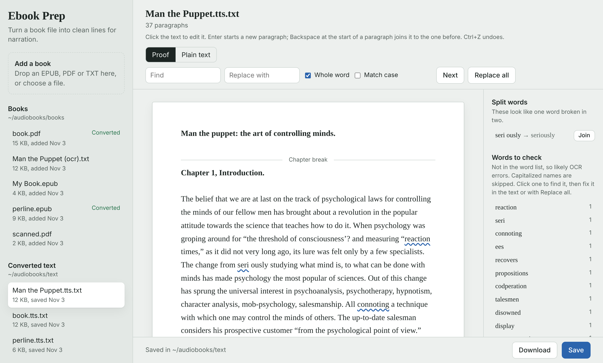

# Ebook Prep

Cleans EPUB, PDF and TXT books into text for
[tts-audiobook-tool](https://github.com/zeropointnine/tts-audiobook-tool) and other
voice-cloning TTS tools. Every line ends at the end of a sentence, page numbers
and running headers are removed, words hyphenated across lines are rejoined, and
scanned PDFs get OCR. A browser page lets you proofread and fix the text before
you generate audio.

This was a project of mine because I love rare books. I use this to convert rare .pdf's to epub and also to then prep that to a txt file that works cleanly with tts-audiobook-tool as I don't always have time to read the books and enjoy listening to them at work.

## What it fixes

- Lines that break mid-sentence (PDF hard wraps, PDF-to-EPUB conversions where
  every printed line became its own paragraph, chapters split across files).
- Words hyphenated or split across lines: "appa-ratus" and "seri ously" become one
  word, while real compounds like "mob-psychology" and "to-day" are kept.
- Page numbers, running headers and footnote reference numbers.
- Headings made speakable: "CHAPTER IV" becomes "Chapter 4."

Output: one paragraph per line, a blank line between paragraphs, two blank
lines before each chapter (tts-audiobook-tool reads 2+ blank lines as a section break).

## Install

Needs Docker with the compose plugin. On NixOS: `virtualisation.docker.enable = true;`
and your user in the `docker` group.

    git clone <this repo> ~/ebook-prep
    bash ~/ebook-prep/ebook-prep.sh on      # first run builds the image, a few minutes

Then open http://localhost:7880

Shell aliases (home-manager `shellAliases`, or add to `.bashrc`):

    prepon  = "bash ~/ebook-prep/ebook-prep.sh on";
    prepoff = "bash ~/ebook-prep/ebook-prep.sh off";

To update after a `git pull`, run `prepon` again; it rebuilds when files changed.

## Folders

- `~/audiobooks/books`: the original files. Upload in the page, or copy files here.
- `~/audiobooks/text`: the cleaned `.tts.txt` files. Load these in tts-audiobook-tool.

Other folders: `BOOKS_DIR=/path TEXT_DIR=/path bash ebook-prep.sh on`

## Using it

1. Pick a book (or drop one on the window) and press Convert.
2. Proof shows the text as it will be read. Click anywhere to edit. Enter starts a
   new paragraph; Backspace at the start of a paragraph joins it to the one before;
   Ctrl+Z undoes.
3. Blue wavy underlines mark words that aren't in the word list, usually OCR
   errors. They're listed on the right: click one to find it, then fix it in the
   text or with Replace all.
4. Split words lists pairs like "seri ously". Join fixes every copy.
5. Save (Ctrl+S). Plain text shows the file exactly as saved, at the same spot.

For PDFs, "Text layer" controls OCR:
- OCR pages with no text: the default; scanned PDFs are read automatically.
- Redo OCR on every page: replaces a bad existing text layer (slower).
- Use the existing text only: no OCR.

## Commands

    ebook-prep.sh on                 # build if needed and start (default)
    ebook-prep.sh off                # stop
    ebook-prep.sh logs               # follow the container output
    ebook-prep.sh update             # rebuild from scratch: fresh OCR and word lists
    ebook-prep.sh cli ~/book.epub    # convert one file without the page; writes
                                     # ~/book.tts.txt (no OCR)

`app/prep_text.py` also runs on its own with plain Python 3 (standard library only):

    nix shell nixpkgs#python3 nixpkgs#poppler_utils -c python3 app/prep_text.py book.pdf

Outside Docker there are no word lists, so hyphen decisions rely on the book's own
spelling and the words-to-check list is empty.

## Layout

    Dockerfile           Debian + poppler, ocrmypdf/tesseract, English word lists
    docker-compose.yml   port 7880 on localhost, the two folders, your user ID
    ebook-prep.sh        launcher
    app/prep_text.py     the converter (also a command-line tool)
    app/server.py        small web server, standard library only
    app/static/index.html  the page

The container only listens on this computer. To open it from another machine on
your network, change the port line in `docker-compose.yml` to `"7880:7880"`.
